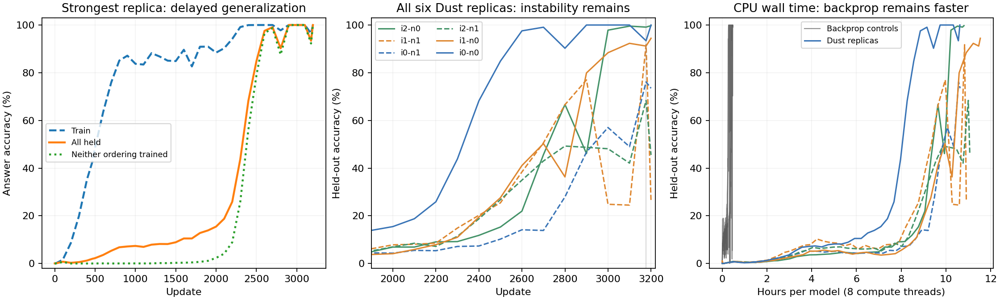

# Grokking in only 11 hours 🙂

CPU-only, zero backprop training, and an actual held-out result.
This is a source-derived adaptation of [Dust](https://github.com/qlabs-eng/dust)
to the released grokking transformer, not a reproduction of the FineWeb benchmark.
Upstream authors and anyone interested in derivative-free learning are welcome
to inspect, reproduce, criticize, or improve it.

## What happened

One fresh Dust model reached **100% on all 6,586 held-out modular-addition
equations**, including all **4,669 pairs with neither ordering trained**.
It used eight CPU compute threads and finished 3,200 updates in **10.62 hours**.
The six replicas ran independently across six machines; this was not 48 CPUs
cooperating on one model. All six received **zero backprop updates or warm starts**.
Gradient diagnostics and backprop controls were separate.

| Initialization | Noise seed 9278901 | Noise seed 9278902 |
|---|---:|---:|
| 9278700 | 100.00% | 73.49% |
| 9278701 | 94.44% | 26.19% |
| 9278702 | 99.73% | 45.52% |

These are final all-held accuracies at the fixed 3,200-update horizon, not
best-checkpoint selection. All six took 10.62–11.53 hours each. Separate paired
backprop controls first exceeded 99% held-out in 17–27 minutes and completed
10,000 updates in 27–29 minutes. **This is a feasibility result, not a speed win.**

The strongest run passed the prewritten grokking criterion: training accuracy
exceeded 99% at update 2300 while held-out accuracy was 43.82%; held-out accuracy
first exceeded 99% at 2700, and was 100% at three consecutive checks at
2900/3000/3100. Persistence was established at 10.33 hours. Strictly unseen
accuracy rose from 2.33% at 2000 to 56.20% at 2400 and 100% at 3000.
This did not have a long perfectly memorized plateau.



Stability is unfinished business. Even the strongest run regressed to 93.40%
all-held at 3177 before recovering. Another replica fell from 91.74% at 3177
to 26.19% at 3200. Only one replica satisfies the full prewritten delayed and
persistent grokking criterion; a second finished near-perfect without satisfying
the required memorization-before-generalization ordering.

At the predeclared primary endpoint **3177**, averaging all six probability
vectors or logits gave **100% held-out accuracy**, including the strict unseen
pairs. No held-out labels chose weights, temperatures or members. This is a
six-model ensemble, with six-model inference cost.

## Verify the result in seconds

From this directory, use Python 3.10+ with CPU PyTorch and NumPy. Tested versions
were PyTorch 2.14.1+cpu and NumPy 2.2.6; numerical trajectories can depend on the
PyTorch build and CPU kernels.

```bash
python3 -m pip install -r requirements.txt --extra-index-url https://download.pytorch.org/whl/cpu
OPENBLAS_NUM_THREADS=1 OMP_NUM_THREADS=2 timeout 120s python3 -m src.verify_release
OPENBLAS_NUM_THREADS=1 OMP_NUM_THREADS=2 timeout 180s python3 -m unittest discover -s tests -v
```

The verifier checks exported checkpoint hashes, recomputes predictions with the
answer token physically absent, checks recorded held-out results and rebuilds
both six-model primary-endpoint ensembles. Checkpoints are evaluation exports:
optimizer state and perturbation RNG are omitted, so they cannot resume the
original training trajectory.

## Train from scratch

```bash
# Strongest observed seed. Allow up to 20 hours; the external guard enforces it.
bash scripts/run_cpu.sh --output runs/new-dust --method dust \
  --model-seed 9278700 --noise-seed 9278901 --steps 3200

# Separate matched control, fresh initialization.
bash scripts/run_cpu.sh --output runs/new-bp --method bp \
  --model-seed 9278700 --noise-seed 9278901 --steps 10000
```

The portable runner uses the original estimator through update 600 and the
validated CPU execution path thereafter, matching the reported study. That
change preserves estimator/noise semantics and Adam state; floating-point
arithmetic is not bitwise identical. The original runs included a checkpointed
migration with no model, optimizer or RNG reset. Fresh replay avoids that
operational interruption. Neither the eleven-hour timing nor a seed's exact
trajectory is guaranteed on a different machine.

## Task and deviations from upstream Dust

Addition modulo 97; all 9,409 ordered pairs; fixed RandomState(0) 30/70 split;
shared 239-token vocabulary; six-token input `EOS a + b = c`; causal prediction
of `c` at the equals position and EOS at the next position. Architecture:
two postnorm blocks, width 128, four heads, ReLU MLP width 512, sinusoidal
positions, 455,424 parameters including LayerNorm gains and biases.

The matched optimizer is AdamW, lr .001, betas (.9,.98), decay 1 on every
parameter and ten-step warmup. Our P16 means sixteen draws per site, not the
paper's total direct-draw allocation. We retain clean caches, independent
module perturbations, zeroth-order head estimates, and local attention credit.
Sparse supervision requires future-token credit for causal paths. LayerNorm
gain/bias reconstruction, centering corrections, smaller direct noise and
the released grokking architecture are declared adaptations.

See [PROTOCOL.md](PROTOCOL.md), [seed results](SEED_REPLICA_RESULTS.md), and
[ensemble results](ENSEMBLE_RESULTS.md). Portable raw metrics/configurations are
in [results](results); checksum-listed weights are in [checkpoints](checkpoints).
Historical reports also reference collection paths from the original cluster;
the exported evidence above is the portable subset.

We did not benchmark EGGROLL on this setup. Dust's language-model population
ratios cannot establish that EGGROLL would take a year on this CPU task.

The upstream Dust code remains at commit
`b20f7c03eac630b6441ba6f254128c1761dc45ad`; original MIT notices are retained.
Released grokking reference files retain their OpenAI MIT license.
